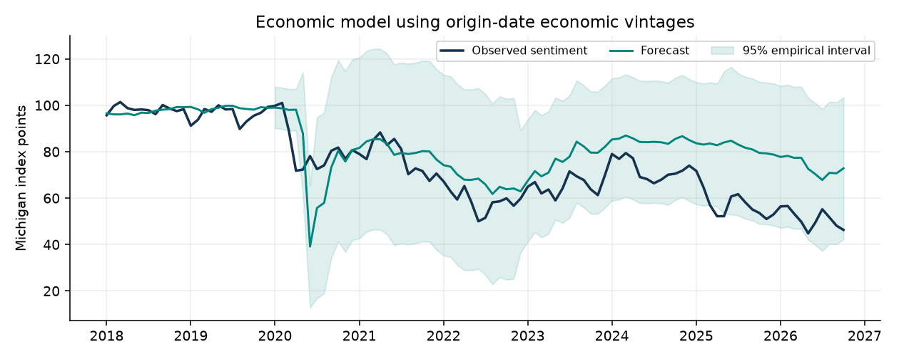
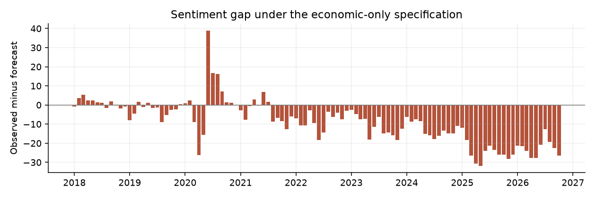
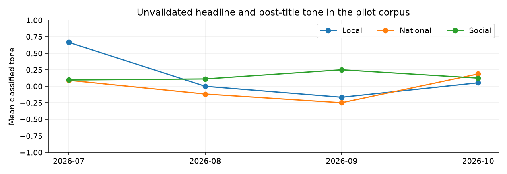

# Economic narratives and US consumer sentiment before the 2026 midterm elections

AI Applications in Finance final projectResearch cutoff 14 October 2026. Historical estimation begins in January 2010.

## Abstract

This study combines a real-time economic forecasting exercise with a documented pilot of 316 US-relevant news headlines and Reddit post titles. Across 105 final monthly outcomes from January 2018 through September 2026, an expanding-window model using unemployment, headline PCE inflation and real GDP growth has an RMSE of 14.10 Michigan index points. A persistence benchmark using the latest sentiment observation in the same data vintage has an RMSE of 4.75. Adding lagged sentiment reduces the economic model RMSE to 5.19.

The economic-only October forecast is 72.85, compared with the preliminary observed index of 46.3. Its gap of -26.55 points shrinks to -6.81 when recent sentiment is included. Both observations fall inside the corresponding empirical prediction intervals. An unexplained residual therefore depends strongly on specification and does not establish perceptual bias.

A financial-text classifier achieves external macro F1 0.796, compared with 0.543 for a dictionary. Its project-domain accuracy remains unvalidated. A separate retrospective comparison using the San Francisco Fed news index changes dynamic-model RMSE from 5.19 to 5.23, providing no stable full-window gain. Historical index vintages are unavailable, and the own-text pilot covers only four months. The study establishes neither a causal media effect nor a validated null effect.

| Completed evidence | Scope |
| --- | --- |
| Economic vintages | 202 verified monthly ALFRED snapshots |
| Forecast evaluation | 105 final months plus October preliminary monitoring |
| Media pilot | 316 items, national and local news plus Reddit |
| Independent human validation | Not completed; 300-item blind annotation package prepared |

## Research questions

The analysis asks how media bias can be operationalized, how much headline indicators explain sentiment, which perceptual mechanisms the data can measure, whether media adds predictive value, and what evidence would contradict a media explanation. It treats real household pressures, framing, measurement changes and omitted variables as competing explanations rather than assuming that pessimism is irrational.

# Economic data and source reconciliation

The supplied spreadsheet contains four independent series with different observation dates on the same row. This study preserves it unchanged, extracts each series separately and uses independently downloaded official values for the analysis. BLS supplies the seasonally adjusted U-3 unemployment measure. BEA supplies PCE prices, real GDP and real disposable personal income, distributed through FRED and ALFRED. Michigan supplies consumer sentiment and survey components. [1–5]

| Measure | Definition and treatment |
| --- | --- |
| U-3 unemployment | Latest officially available rate in each forecast-date vintage, percent of civilian labor force |
| Headline PCE inflation | 100 × (PCE price index / same index 12 months earlier − 1), calculated within the vintage |
| Real GDP growth | 100 × ((latest real GDP / prior-quarter real GDP)^4 − 1), quarter-on-quarter annualized |
| Household controls | Real disposable personal income YoY and cumulative PCE price growth over 36 months |
| Sentiment | Latest available Michigan headline value for predictors; final cutoff-vintage values for scoring |

## Material discrepancies

The supplied August 2026 PCE figure is 3.00759%, while the official index calculation yields 3.41903%, consistent with BEA’s rounded 3.4% release. Across 212 overlapping observations, 197 differ by more than 0.05 percentage point. Unemployment and headline sentiment agree with downloaded FRED values over the matched periods. GDP differs by more than 0.05 point in 46 of 74 matched quarters, which may reflect revisions or other source differences. These findings justify replacing the supplied series rather than assuming a single correct transformation. [1,2]

The supplied 2026Q3 GDP value of 3.7% is excluded. BEA schedules the advance estimate for 29 October, after this study’s cutoff. The most recent published quarter is 2026Q2. The October sentiment label is a month identifier, not a publication date: 46.3 is the preliminary value released on 9 October, with the final value scheduled for 23 October. [3,5]

October 2025 unemployment is structurally unavailable because the household survey was not collected during the federal shutdown. No zero, linear interpolation or reconstructed observation replaces it. Forecast inputs use the latest actually available observation, and the retained observation date makes its age inspectable. [4]

## Provenance

Raw files, retrieval URLs, hashes and vintage dates are preserved. Audit tables report supplied-versus-official differences without assigning an unsupported cause. FRED downloads and archival data are research snapshots, not immutable ground truth.

# Chronological forecasts and information timing

Each prediction targets the sentiment index for a calendar month. The forecast origin is the first day of that month, and the information cutoff is the end of the preceding calendar day. For each of 202 origins from January 2010 through October 2026, the collector requests an ALFRED historical snapshot and verifies that every returned series header has the exact requested vintage date. Header mismatch or download failure stops the analysis rather than silently substituting current data. [6]

Predictors use the latest nonmissing observation actually present in that snapshot. PCE inflation uses the same vintage for numerator and denominator. Quarterly real GDP remains quarterly: the last released quarter supplies the growth measure until another observation becomes available. This creates a stepwise information series, not artificial monthly GDP estimates. Changing chained-dollar base years does not invalidate the within-vintage growth ratio.

| Model | Predictors |
| --- | --- |
| Persistence | Latest available headline sentiment |
| Economic | U-3, PCE YoY, real GDP QoQ annualized |
| Economic plus persistence | Economic variables and latest available sentiment |
| Economic plus household controls | Previous model plus income YoY and three-year price growth |
| Seasonal and method sensitivity | Previous model plus annual sine/cosine and the April–July 2024 web transition ramp |

Models estimate ordinary least squares with predictors standardized using only the training observations. Expanding-window training starts in 2010. Evaluation begins in January 2018, providing at least eight years of initial history. At every origin, a historical sentiment observation enters training only if that origin’s vintage contains it. Training therefore avoids both future observations and later sentiment revisions. Final sentiment values available at the study cutoff score the forecasts; the October preliminary observation remains outside the main accuracy table.

The persistence comparator respects ALFRED distribution availability, which can lag the direct Michigan release. For example, at the October origin its latest sentiment observation is August, even though Michigan had already published September. This is a conservative reproducible benchmark, not the strongest possible real-time trading benchmark. Economic-only results are unaffected by that sentiment distribution lag.

## Sentiment gap

For model m and month t, gap(m,t) = observed sentiment(t) − forecast(m,t). The gap is a specification-dependent forecast error. No transformation of it into a measured cognitive bias or media effect is justified.

# Economic forecasting results

| Model | RMSE | MAE | Months |
| --- | --- | --- | --- |
| Persistence | 4.75 | 3.73 | 105 |
| Economic | 14.10 | 10.82 | 105 |
| Economic plus persistence | 5.19 | 3.98 | 105 |
| Economic plus household controls | 5.54 | 4.20 | 105 |
| Retrospective macro plus news | 13.92 | 10.59 | 105 |
| Retrospective macro plus news and controls | 12.49 | 8.90 | 105 |
| Retrospective dynamic plus news | 5.23 | 4.00 | 105 |

The three headline economic indicators track some broad variation in sentiment but forecast poorly during later regimes. Their squared errors are 25.8% lower than squared deviations around the holdout sample’s own mean. This descriptive comparison uses a retrospective mean and is neither a causal explained share nor an implementable forecast benchmark. The more relevant persistence comparator is substantially more accurate.

Economic-only RMSE is 3.42 before the pandemic, 12.33 during 2020–2021 and 17.24 during 2022–September 2026. The corresponding persistence errors are 3.55, 6.27 and 4.44. A stable relationship learned in an earlier period cannot be assumed to describe the inflation and recovery period.

Adding recent sentiment improves the economic-only forecast but does not outperform persistence. Income and accumulated-price controls do not improve the dynamic model. This does not show that household pressures are unimportant.

The separate retrospective test uses the mean San Francisco Fed news index from month t-2, a conservative calendar lag. This lexical index covers economics-related articles from major US newspapers. Its current reconstructed history changes macro RMSE from 14.10 to 13.92 and dynamic RMSE from 5.19 to 5.23. Historical index vintages and construction information are unavailable, so these results cannot establish real-time predictive gains. [11]

# Uncertainty and specification sensitivity

Empirical intervals use the absolute errors of previous genuine forecasts, scored with sentiment values present in the current origin vintage. The calibration window contains up to 60 past errors and requires at least 24. The 95% radius uses a finite-sample adjusted empirical quantile. Time dependence and regime change prevent a guarantee of nominal coverage.

| October preliminary monitoring | Forecast | Gap | 95% interval |
| --- | --- | --- | --- |
| Economic only | 72.85 | -26.55 | 42.26 to 103.43 |
| Economic plus persistence | 53.11 | -6.81 | 43.43 to 62.78 |

Both intervals contain 46.3. Over the 81 final months with available intervals, economic-only coverage is 93.8% and dynamic-model coverage is 97.5%. These are calibration diagnostics, not tests of a media hypothesis. A large gap accompanied by a very wide interval indicates a weakly informative baseline.

Paired squared-error comparisons use a circular moving-block bootstrap with six-month blocks, 2,000 replicates and a fixed seed. Economic-only minus persistence mean squared loss is 176.21, with a 95% bootstrap interval of 86.21 to 281.01. For the dynamic economic model the difference is 4.39, with an interval of −1.10 to 12.27. The latter does not establish an improvement.

A fixed model trained with information available by 31 December 2019 performs worse after 2020: RMSE rises to 28.75 for the economic model and 13.11 for the dynamic model. The seasonal and survey-method sensitivity has RMSE 5.22 in the expanding-window test. Coefficient paths and six-lag heteroskedasticity and autocorrelation robust standard errors are provided in the analytical package.

These comparisons are exploratory. The economic-only versus persistence comparison is the primary benchmark; additional controls and windows are sensitivity checks. No causal interpretation or significance claim based on selecting the most favorable result is made.

# Media corpus and sampling limitations

The focused corpus contains 316 distinct titles published from 1 July through 14 October 2026: 127 national news headlines, 33 local news headlines and 156 Reddit post titles. These are sampled content items, not full articles, comments, engagement measures or observations of survey respondents’ exposure.

| Collection component | Protocol |
| --- | --- |
| National news | Reuters, AP, CNBC, CNN, Fox Business and NPR, supplemented by documented US publisher feeds and searches |
| Local news | A documented pool including Texas Tribune, CalMatters, Chicago Tribune, Philadelphia Inquirer and Minnesota Star Tribune |
| Social platform | Public Reddit feeds and searches; actual community names parsed from post URLs |
| Search vocabulary | Economy, inflation, unemployment, cost of living; supplementary layoffs, hiring, grocery prices and housing affordability |
| Deduplication | Normalized title equality across sources and reposts; near-identical syndication may remain |
| Geographic screening | Exclude explicit foreign-only focus; US relevance otherwise inferred from source/community and flagged as unverified |

The collector attempted monthly historical searches from 2018 onward. Many feeds returned recent or otherwise out-of-window records. The pipeline rejects those records rather than relabeling their dates or treating empty months as neutral coverage. Five isolated older economically relevant items remain in a separate sparse archive and do not supply a historical monthly media panel.

Direct publisher feeds supplement search-ranked retrieval. Headline relevance screening excludes obvious homepages and titles without an economic topic. Source pools and retrieved records are inspectable, but they do not create a probability sample of US media. The small local sample and the large Reddit share limit balance and generalizability.

The four monthly sample sizes are 2026-07: 35, 2026-08: 40, 2026-09: 34, 2026-10: 207. October is partial and accounts for most retrieved items. Neither raw item counts nor month-to-month tone changes can be interpreted as a change in national attention without a stable sampling denominator.

## Privacy and access

Usernames are unnecessary and removed from retained Reddit feeds. Analyses retain post-title metadata and links, not personal profiles. Public availability does not imply unrestricted redistribution. The package preserves source attribution, confines reuse to this academic project and includes the benchmark’s noncommercial share-alike license. No human participants were recruited.

# NLP coding and external benchmark validation

The coding scheme separates economic tone, topic salience, framing, numerical claims and political actor mentions. Tone uses a multinomial Naive Bayes model with Laplace smoothing, trained on the unanimous-agreement Financial PhraseBank subset. That dataset concerns company financial news, so its label meaning and writing style differ from household economic perceptions. A transparent positive/negative word dictionary supplies a conventional baseline. [9]

| Dimension | Operationalization and limit |
| --- | --- |
| Tone | Negative, neutral or positive financial language; probabilistic output is not calibrated confidence |
| Selection and salience | Binary mentions of layoffs, hiring, prices, growth and recession; counts require an explicit sampling denominator |
| Framing | Price levels versus inflation rates, households versus aggregates, and forward-looking wording |
| Factual calibration | Numeric-claim detection plus narrow release matching only when measure, period and publication timing are explicit |
| Political attribution | Actor mentions flagged for credit/blame review; mention alone does not establish attribution or bias |

After normalized exact deduplication, the external benchmark contains 2218 sentences. A fixed, class-stratified split assigns 1775 to training and 443 to testing. The split does not remove every near-duplicate or shared issuer, so it may still overstate generalization. Token vocabulary and probabilities are learned only from the training split.

| Held-out measure | Naive Bayes | Dictionary |
| --- | --- | --- |
| Accuracy | 0.849 | 0.713 |
| Macro F1 | 0.796 | 0.543 |
| Negative F1 | 0.718 | 0.388 |
| Neutral F1 | 0.910 | 0.834 |
| Positive F1 | 0.760 | 0.405 |

Negative-class recall is 0.627, illustrating why a favorable overall score does not guarantee reliable identification of pessimistic headlines. Class-level precision, recall, confusion matrices, model vocabulary, probabilities, dataset hash and random seed are saved. No LLM API was called. An optional structured LLM prompt is included for a future comparison and clearly marked as unexecuted.

The required 300-item project sample has two blinded annotation files and a guide, but no genuine independent human labels. Cohen’s kappa, adjudicated corpus F1 and source-specific AI accuracy therefore remain unavailable. Two automated methods are not represented as two human annotators.

# Media pilot findings and perceptual mechanisms

The classifier assigns 34 items to negative, 211 to neutral and 71 to positive. These are model outputs rather than validated population proportions. The classifier and dictionary disagree on 54.7% of items, a substantial warning about domain transfer and label interpretation.

Political-name substitutions change none of 36 tested tone labels. Source labels are not model inputs, so changing them has no effect by construction. Neither result establishes political neutrality: a bag-of-words model may ignore names while still mishandling framing. The audit preserves item IDs and the original and substituted classifications.

The pipeline flags 47 titles containing numerical claims. One matches a deliberately narrow official release benchmark, while the remaining claims require further source review. This is not a fact-checking accuracy estimate. Automated calibration abstains when periods, core-versus-headline distinctions, or annual-versus-monthly units are ambiguous.

| Mechanism | What these data establish |
| --- | --- |
| Selective coverage or framing | Observable differences in sampled content; source-matched event comparisons are needed to call a difference biased |
| Negativity bias | Negative language can be measured; disproportionate reader response cannot |
| Availability bias | Requires exposure or recall measures, absent here |
| Confirmation bias | Requires prior beliefs and selective exposure or belief updating, absent here |
| Anchoring to past prices | Three-year price growth is an economic control; it does not identify a psychological anchoring effect |

The source-equal weighting sensitivity prevents prolific publishers from receiving all the weight, but it cannot repair missing sources or uncertain audience reach. Price-level framing is a plausible response to accumulated costs. Falling inflation does not imply that prices return to earlier levels. No observed text pattern is converted into a diagnosis of irrational consumers.

Own-text media forecast tests remain unestimable with four bins. The external news-index supplement permits a retrospective comparison: the full-window dynamic squared-loss difference is 0.41, with bootstrap interval −0.80 to 2.26. In the 2021-onward sensitivity, RMSE changes from 4.78 to 4.71. This modest period-specific gain, without historical index vintages or multiplicity adjustment, does not establish a stable real-time effect.

# Causal design and evidence that could contradict the hypothesis

This project follows the assignment’s observational-analysis-with-causal-design-proposal option. Economic shocks can affect both coverage and sentiment. Publishers respond to demand, while pessimistic readers can choose negative material. Political affiliation, household finances and local conditions can influence both exposure and responses. A regression of national sentiment on headline tone would therefore combine several causal and noncausal paths.

## Proposed randomized framing experiment

Subject to required institutional review and informed consent, recruit US adults through a panel and randomly assign them to two truthful descriptions of the same official economic release. One emphasizes the current inflation rate and recent direction. The other emphasizes the price level relative to a fixed earlier date. Both contain the same numbers, dates, definitions, source links and uncertainty. Randomization occurs at the person level, with one primary outcome chosen before recruitment.

Measure baseline economic beliefs, perceived personal financial pressure, political affiliation and recent news exposure before treatment. The primary endpoint is the immediate change in a prespecified economic outlook scale. Secondary endpoints are numerical recall and expectations about personal finances. A follow-up after one week measures persistence. All stimuli avoid deception and instructions to favor a political candidate.

Estimate the intention-to-treat difference with baseline-outcome adjustment. Report attrition, randomization balance, compliance and confidence intervals. For planning only, a standardized effect of 0.20, 80% power and a two-sided 5% threshold imply approximately 392 participants per arm before attrition using a normal approximation. This is an illustrative power calculation, not an enrollment commitment or evidence from an executed experiment. Baseline adjustment may improve precision, but its benefit should not be assumed in the power target.

## Scope and transportability

The experiment identifies an effect of assigned wording in that sample, not an effect on the national Michigan index. A national claim would additionally require representative sampling, estimates of actual exposure and repetition, comparable survey outcomes, population weighting, and defensible transportability assumptions. A regional quasi-experiment would need a plausibly external exposure shock, stable pre-trends, interference analysis and protection against coincident local economic shocks.

## Results that would weaken a media explanation

Evidence against the proposed mechanism would include no predictive gain in a sufficiently long and genuinely held-out media panel; disappearance of the association after stable household and political controls; null framing effects with confidence intervals narrow enough to rule out meaningful changes; or strong prediction by future media tone, suggesting common shocks or reverse causality. Equivalent negative and positive economic surprises should be compared within release type and source. Accurate negative reporting during genuine deterioration would not support a factual-bias claim.

A future null result must distinguish limited power from informative absence of an effect. The own-text pilot and the retrospective external-index comparison, without human validation or historical index vintages, cannot supply a causal null finding.

# Monitoring and financial forecasting implications

The local dashboard displays the observed index, selectable model forecasts, empirical intervals and the model-specific gap. It also shows media sampling composition, tone and framing flags, numerical claims awaiting review, model comparisons, data discrepancies and relevant releases. Filters expose source type, publication month and title searches. It runs from a local HTML file without external scripts or tracking.

## Prospective update plan

| Date or trigger | Update action |
| --- | --- |
| 23 October 2026 | Replace October preliminary sentiment only after the final release is available; preserve both versions |
| 29 October 2026 | Add Q3 advance GDP and September PCE after publication; never backfill them into earlier forecast origins |
| Each later forecast origin | Fetch the previous-day economic vintage, verify headers and rebuild the forecasts |
| Daily or weekly media refresh | Use the same sources and search vocabulary, record collection failures and retain publication dates |
| After sufficient historical coverage | Compare economic, economic-plus-media and media-plus-controls on common chronological holdouts |
| After independent annotation | Adjudicate disagreements, compute agreement and source-specific model performance, then reconsider media findings |

The current research cutoff precedes election day. Data collection should continue under the same protocol, with a new cutoff explicitly declared for each analytical version. Election proximity alone does not identify an election effect. Historical elections, common economic shocks and the changing composition of sources would need to be addressed before such an attribution.

## Practical implication

For forecasting or risk monitoring, a weak economic baseline can manufacture an apparently large sentiment anomaly. In October, the economic-only gap is −26.55 points, while the dynamic specification gives −6.81. A risk dashboard should display the model, uncertainty and input dates beside the gap, and evaluate a persistence benchmark before treating the residual as an independent signal.

Media metrics are currently indicators of sampled narratives and measurement uncertainty. They should not trigger a trading or credit decision on the basis of this study. A validated incremental forecast gain would need to survive alternative source weights, lag choices, household controls and evaluation periods. A causal effect would require additional exposure or experimental evidence.

## Survey heterogeneity

Michigan’s August chart shows income-group sentiment of 44.6, 50.4 and 60.0 from the lowest to highest income thirds. Party averages are 85.5 for Republicans, 40.1 for Democrats and 47.3 for independents, with the latter series explicitly labeled as three-month moving averages. These descriptive differences motivate moderator and confounder analysis but do not connect an individual’s media diet to their response. [7,8]

# Limitations and assignment coverage

The strongest completed evidence is the vintage-aware economic forecasting exercise. The media component includes an external NLP benchmark, an own-text pilot and a retrospective historical news-index comparison. Independent human validation and genuine real-time validation of media measures remain unmet. This report does not represent those requirements as completed.

| Requirement | Status and implication |
| --- | --- |
| Economic measurement and timing | Completed with 202 exact-date archival snapshots, official definitions and no interpolated GDP |
| Alternative explanations | Income and accumulated-price controls tested; political and survey-group differences discussed descriptively |
| National and local news plus social media | Collected, but unbalanced: 127 national, 33 local and 156 social items |
| Validated AI measurement | External benchmark completed; project-domain validation unavailable |
| Two independent annotators and 300 items | 300-item materials prepared; no human annotations, agreement or adjudicated accuracy |
| Economic versus media forecast comparison | Historical external-index comparison completed retrospectively; own-text panel and index vintage validation unavailable |
| Causal analysis | Detailed observational causal-design proposal completed; no causal effect estimated |
| Dashboard and reproducibility | Local dashboard, retained snapshots, scripts, specifications and checks provided |
| Report and presentation | Twelve-page report and a presentation designed for six to eight minutes |

## Additional statistical limits

The holdout spans several economic regimes but remains one national time series. Monthly observations are dependent. A six-month bootstrap block and a simple seasonal sensitivity cannot resolve every form of dependence or omitted variable. GDP measurement is aggregate, PCE is a broad average, and income series do not reproduce every household’s experience. A linear conditional mean can fail when relationships change.

The partial October media sample is much larger than earlier samples. Search relevance rankings, selection by keywords, duplicate syndication, incomplete publisher coverage and source availability can change measured tone. The lexicon frames also have false positives and false negatives. Bot activity and advertising are not reliably observable from retained title metadata, so a complete bot or ad exclusion cannot be claimed.

The 2024 survey transition warrants a sensitivity check. Michigan’s own 2026 methodology report argues that low sentiment persists under comparable collection methods and is not adequately explained by the web transition or political composition alone. That evidence cautions against using a survey-method dummy as a complete explanation. This project does not independently replicate the survey’s microdata analysis. [7,8]

## Conclusion

The evidence supports careful economic measurement and model benchmarking before interpreting a sentiment gap. It does not currently support the claim that biased media caused depressed US consumer sentiment, nor does it rule out a media contribution.

# References and reproducibility

[1] BLS and BEA official economic series distributed through FRED including UNRATE PCEPI GDPC1 DSPIC96 and UMCSENT.https://fred.stlouisfed.org/series/UNRATE

[2] BEA Personal Income and Outlays August 2026, released 30 September.https://www.bea.gov/news/2026/personal-income-and-outlays-august-2026

[3] BEA 2026 release schedule and real GDP series.https://www.bea.gov/news/schedule/full

[4] BLS Employment Situation November 2025, explaining the October survey interruption.https://www.bls.gov/news.release/archives/empsit_12162025.htm

[5] University of Michigan preliminary October 2026 sentiment and components.https://www.sca.isr.umich.edu/

[6] ALFRED documentation on historical observation vintages.https://alfred.stlouisfed.org/help/downloaddata

[7] University of Michigan 2024 methodological transition announcement.https://www.sca.isr.umich.edu/files/methodtransitionannouncement2024.pdf

[8] University of Michigan Sentiment Web Based Data Collection and Partisanship, 10 July 2026.https://data.sca.isr.umich.edu/fetchdoc.php?docid=81444

[9] Malo and colleagues Financial PhraseBank, CC BY NC SA 3.0 dataset mirror.https://huggingface.co/datasets/takala/financial_phrasebank

[10] University of Michigan historical chart tables and subgroup data.https://data.sca.isr.umich.edu/charts.php

[11] Federal Reserve Bank of San Francisco Daily News Sentiment Index.https://www.frbsf.org/research-and-insights/data-and-indicators/daily-news-sentiment-index/

## Analytical package

The README describes the dataset layout, dependency setup and offline reproduction. Run python run_project.py --offline to regenerate analyses, figures and the dashboard from the retained snapshots. Run python -m unittest discover -s tests to execute the integrity checks. Report and presentation builders use the generated result files rather than manually retyped results.

Exact forecast inputs are in data/processed/forecast_features.csv. The results directory contains predictions, accuracy metrics, model comparisons, coefficient paths, benchmark confusion matrices, media composition, name-swap probes and the data reconciliation. Collection manifests retain queries, date windows, URLs and content hashes. The annotation guide defines the independent labeling and adjudication procedure.

The report and presentation describe the frozen 14 October 2026 snapshot. Future refreshes require a new declared cutoff, new economic vintages and updated release information. Reproduction is deterministic within the documented environment. Network refreshes can change source coverage or revisions and are a new research version, not a byte-identical rerun.
